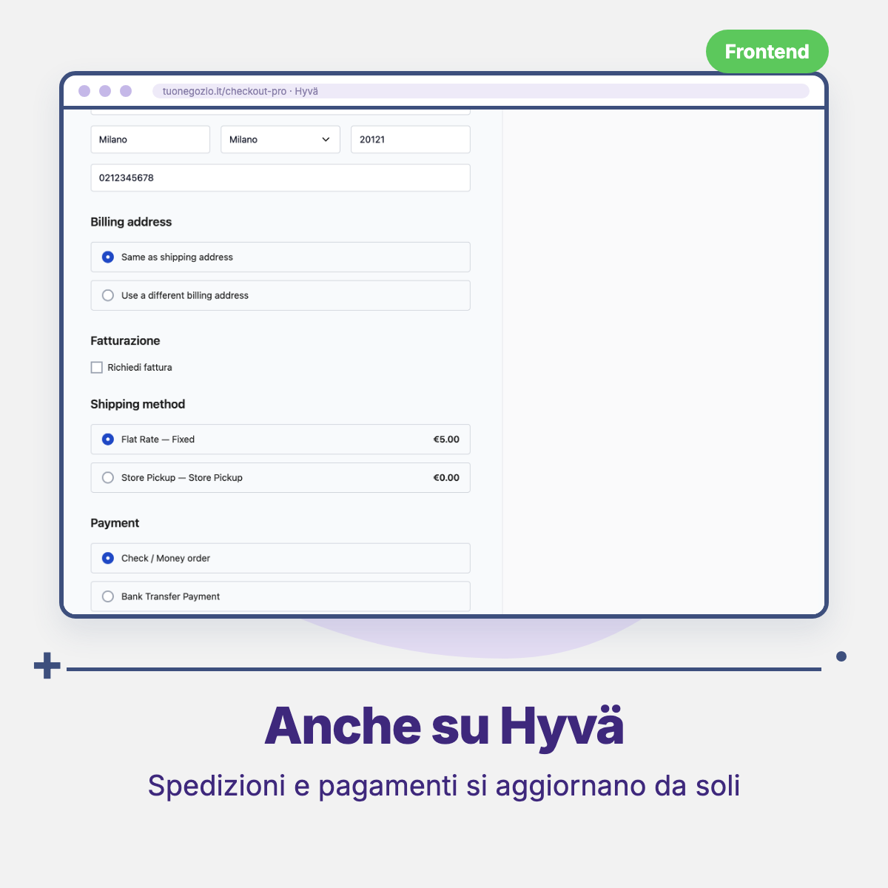
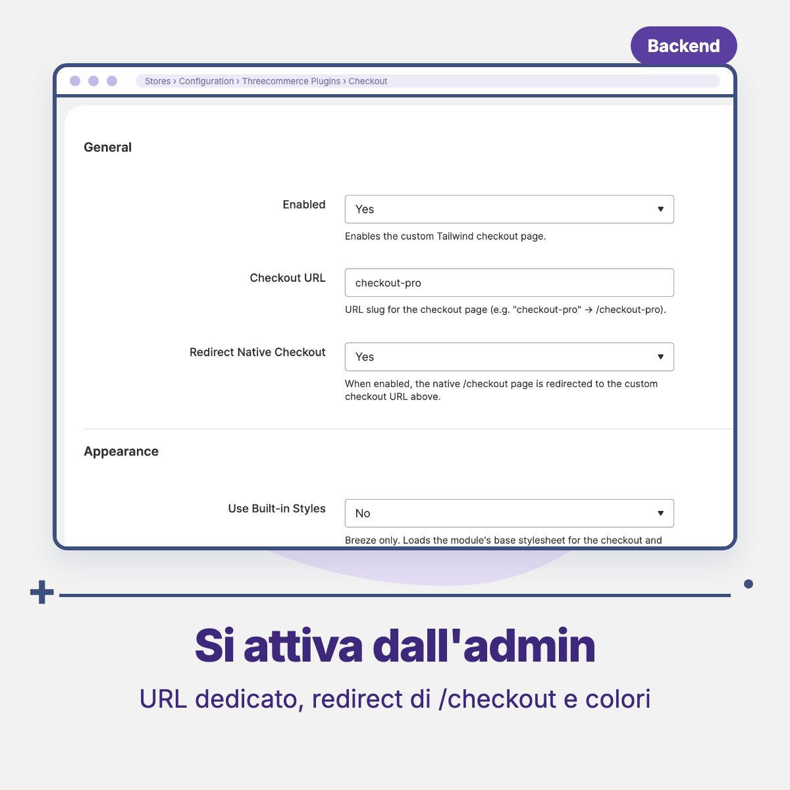

# Threecommerce_OneStepCheckout: single-page checkout for Magento 2 / Mage-OS

A **single-page, Shopify-style checkout** for Magento 2 and Mage-OS, with two frontends in the same module: **Swissup Breeze** and **Hyvä**.

**Compatibility:** Magento Open Source / Adobe Commerce 2.4.4 – 2.4.9 · Mage-OS 1.x / 3.x · PHP 8.1 – 8.4 · Themes: Breeze, Hyvä
**License:** commercial · coming soon

## Features

- **Breeze frontend**: plain markup (BEM classes) and vanilla JavaScript on Magento's native REST API (guest and customer carts), with an optional built-in stylesheet.
- **Hyvä frontend**: reactive form with Magewire (Tailwind + Alpine) and order placement through GraphQL.
- The frontend is chosen automatically from the active theme.
- Layout: the whole form always visible on the left (contact, address, separate billing address, shipping method, payment, terms and conditions, order notes, place order); coupon, products and totals summary, and a recap of the entered data on the right. Shipping and payment methods fill in as the address is completed. Below 1024px: single column with a collapsible summary on top.
- Configurable checkout URL (default `/checkout-pro`) and optional redirect of the native `/checkout`, so cart and minicart buttons lead to the new checkout without theme changes.
- Native **Terms and Conditions** of Magento.
- Guest checkout respected: with guest checkout disabled, visitors are sent to the login page.
- Accent and button colors, optional express checkout area (placeholders), order notes field, and clean layout without header and footer.
- Generic extension points for add-ons such as invoice request fields and in-store pickup.

## Requirements

- Magento Open Source / Adobe Commerce 2.4.4+ or Mage-OS
- PHP 8.1 – 8.4
- `magento/module-checkout-agreements` and `magewirephp/magewire` ^1.13
- Breeze: `swissup/module-breeze` with a Breeze theme active
- Hyvä: a Hyvä theme, `hyva-themes/magento2-graphql-tokens` and Magento's GraphQL modules enabled

## Availability

This module is not yet available for purchase. See the [product page](https://www.threecommerce.it/checkout-una-pagina-magento-2?utm_source=github&utm_medium=readme&utm_campaign=magento2-one-step-checkout) for its status, or [contact us](https://www.threecommerce.it/contatti?utm_source=github&utm_medium=readme&utm_campaign=magento2-one-step-checkout) to be notified when it is released or to ask for information.

## Configuration

Admin → **Stores → Configuration → Threecommerce Plugins → Checkout**: enable, checkout URL, redirect of the native checkout, built-in styles (Breeze only), accent and button colors, express area, order notes, header and footer. Terms and conditions use Magento's own settings under *Stores → Terms and Conditions*.

## Documentation and support

- Product page: [threecommerce.it/checkout-una-pagina-magento-2](https://www.threecommerce.it/checkout-una-pagina-magento-2?utm_source=github&utm_medium=readme&utm_campaign=magento2-one-step-checkout)
- [Changelog](CHANGELOG.md) (parts in Italian)
- Support and custom development: [threecommerce.it/contatti](https://www.threecommerce.it/contatti?utm_source=github&utm_medium=readme&utm_campaign=magento2-one-step-checkout)

---

*This repository is the public showcase of the module. The source code is kept in a private repository.*
